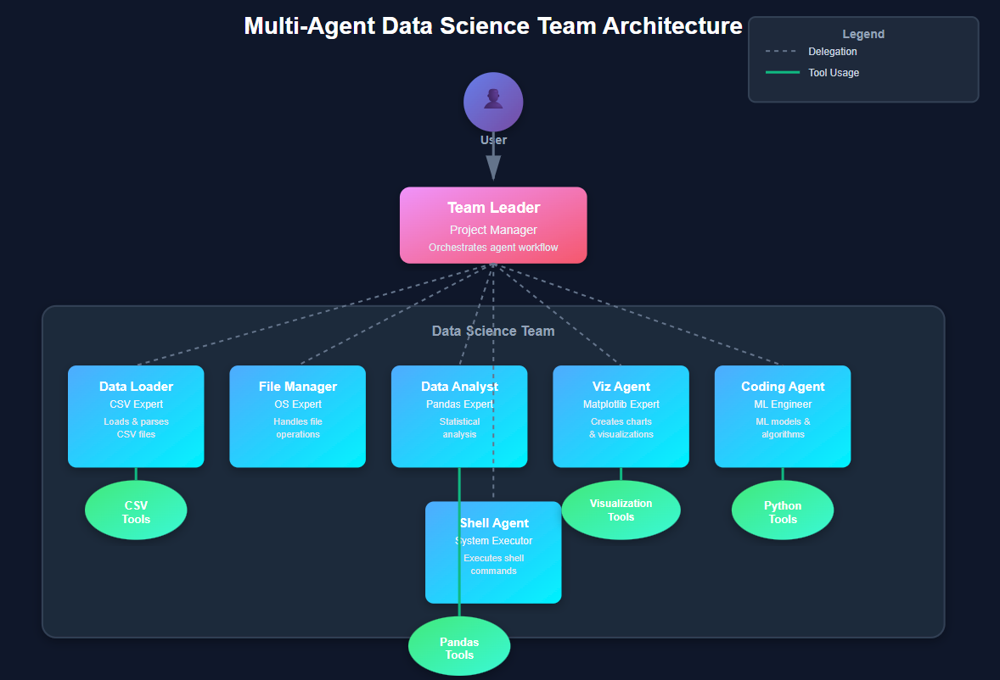
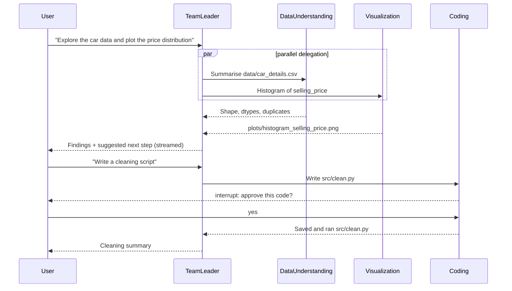

# 🤖 Multi-Agent Data Science Team (LangChain + LangGraph)

An AI-powered data science team where a **Team Leader agent** coordinates **six specialised agents** to take a dataset through the full ML workflow: loading, exploration, cleaning, visualisation, feature engineering, model training and evaluation. You talk to it in plain English, and it plans the work and delegates each step to the right agent.

Built with **LangChain** agents orchestrated by a **LangGraph** supervisor graph. It also has:
- live token streaming
- human-in-the-loop approvals
- persistent SQLite memory
- **LangSmith** tracing
- a **Streamlit** web app and a FastAPI REST API


---

## 📸 System Architecture



### LangGraph graph

This is the actual graph, generated with `graph.get_graph().draw_mermaid()`:


How it works:

1. The **Team Leader** is a tool-calling LLM. To delegate, it calls a `delegate_to_<agent>` tool with a self-contained task.
2. LangGraph routes each call with **`Send`** to that agent's node. **Independent tasks run in parallel.**
3. Each specialist is a LangChain **`create_agent`** (ReAct loop) with its own tools. Its final answer returns to the Team Leader as the tool result.
4. `remember` calls save facts (data paths, model paths, preferences) into the graph's **session notes**.
5. A **SQLite checkpointer** saves the whole state per conversation thread, so the team remembers earlier sessions.
6. Every run is **streamed** (Team Leader tokens + agent activity) and **traced in LangSmith**.

---

## 🎯 Key Features

- **Supervisor multi-agent architecture** built as an explicit LangGraph `StateGraph`
- **Six specialist agents**, each with only the tools it needs
- **Parallel delegation** with LangGraph `Send`
- **Live streaming**: the Team Leader's tokens and each agent's tool calls appear as they happen, in the terminal, the API (Server-Sent Events) and the Streamlit app
- **Human-in-the-loop approvals**: writing a file or installing a package pauses the graph with `interrupt()` until you approve, reject, or reply with feedback
- **Safe mode for public deployments** (`ALLOW_CODE_EXECUTION=false`): agents can explore and plot data but cannot write, run or install anything
- **Sandboxed tools**: file access is limited to the project folder, and shell commands are limited to an allow-list
- **LangSmith tracing**: every agent, tool and LLM call is traced, grouped by conversation thread
- **Persistent memory**: conversations and session notes are stored in SQLite (`memory.db`)
- **Runs on Groq** (`openai/gpt-oss-120b` by default) with retries for Groq's rate limits and malformed tool calls; any other `init_chat_model` provider (e.g. OpenAI) works by changing `MODEL`
- **Model training pipeline** with MAE / RMSE / R² evaluation
- **Tested offline**: 28 pytest tests, including the Streamlit UI and Groq request payloads, run in GitHub Actions on every push

---

## 🏗️ Agents

| Agent | Role | What it does | Tools |
|-------|------|--------------|-------|
| **Team Leader** | Project Manager | Plans the ML pipeline, delegates tasks, keeps session notes | `delegate_to_*`, `remember` |
| **Data Loader** | CSV Expert | Lists datasets and previews rows (max 30) | `list_csv_files`, `read_csv_file`, `list_files` |
| **File Manager** | File System Manager | Lists, reads and writes project files | `list_files`, `read_file`, `write_file`* |
| **Data Understanding** | EDA Assistant | Shape, dtypes, describe, value counts, missing values, duplicates, correlations | `list_csv_files`, `dataframe_operation` |
| **Visualization** | Plotting Assistant | Bar, histogram, scatter, line, pie and box charts saved to `plots/` | `list_csv_files`, `dataframe_operation`, `create_chart` |
| **Coding** | ML Engineer | Writes and runs Python for cleaning, feature engineering, training and evaluation | `read_file`, `write_file`*, `run_python_file`†, `install_package`*, `web_search` |
| **Shell** | Command Executor | Runs `uv run <file.py>` and read-only commands | `run_shell_command`† (allow-listed), `list_files` |

\* needs your approval · † disabled in safe mode (the Shell agent is removed entirely)

### Example flow



---

## 📊 Dataset & Model Results

The demo uses a used-car listings dataset (`data/car_details.csv`, 4,340 rows) with these columns:
`name`, `year`, `selling_price`, `km_driven`, `fuel`, `seller_type`, `transmission`, `owner`.

**Pipeline:** `src/data_cleaning.py` → `src/preprocessing.py` → `src/train.py`

1. **Cleaning** removes 763 exact duplicates and 63 extreme outliers (0.5th–99.5th percentile), and adds `brand`, `model` and `age`.
2. **Preprocessing** scales the numerical columns, one-hot encodes the categorical columns and makes an 80/20 train/test split.
3. **Training** fits three regressors on `log1p(selling_price)` (the price is right-skewed) and keeps the best one by test RMSE.

Test set (703 cars):

| Model | MAE (₹) | RMSE (₹) | R² |
|---|---:|---:|---:|
| **Ridge (best)** | 120,353 | 189,503 | **0.748** |
| HistGradientBoosting | 120,230 | 199,168 | 0.722 |
| RandomForest | 123,793 | 207,495 | 0.698 |

Training on the log target improved R² from 0.706 to 0.748 compared with the raw price. See [reports/model_metrics.md](reports/model_metrics.md).

---

## 📁 Project Structure

```
multi-agent-data-science-team/
│
├── streamlit_app.py           # Streamlit web app (deployable)
├── app.py                     # Terminal chat + FastAPI REST API
├── langgraph.json             # LangGraph Studio config
│
├── ds_team/                   # The multi-agent system
│   ├── config.py              # Paths, LLM, safe mode and LangSmith settings
│   ├── tools.py               # Sandboxed tools (CSV, pandas, charts, files, Python, shell, search)
│   ├── agents.py              # The six specialist agents (create_agent)
│   ├── graph.py               # LangGraph supervisor graph + SQLite checkpointer
│   ├── runner.py              # Streams a turn as events (tokens, delegations, tools, approvals)
│   └── studio.py              # Graph entry point for `langgraph dev`
│
├── src/                       # ML pipeline
│   ├── data_cleaning.py       # Duplicates, outliers, brand/model extraction, car age
│   ├── data_plotting.py       # Before/after selling-price histograms
│   ├── preprocessing.py       # Train/test split, scaling + one-hot encoding
│   └── train.py               # Trains and evaluates models (MAE / RMSE / R²)
│
├── tests/                     # 28 pytest tests (scripted model + fake Groq client, no API key needed)
├── .github/workflows/         # CI: runs the tests on every push
├── .streamlit/                # Streamlit config + secrets template
│
├── data/                      # car_details.csv (raw), cleaned data, features/, uploads/
├── models/                    # preprocessor.joblib, model.joblib
├── plots/                     # Charts created by the agents
├── reports/                   # EDA reports, cleaning log, model metrics
├── clean_car_data.py          # Standalone cleaning script
├── run_car_report.py          # Markdown EDA report for the dataset
│
├── .env.example               # Template for API keys and settings
├── pyproject.toml / uv.lock   # Dependencies (uv)
├── requirements.txt           # Runtime dependencies for pip users
├── requirements-dev.txt       # + pytest and LangGraph Studio
└── LICENSE
```

---

## 🚀 Getting Started

### Prerequisites

- **Python 3.13+**
- [uv](https://docs.astral.sh/uv/) (recommended) or pip
- A free **Groq API key** from [console.groq.com/keys](https://console.groq.com/keys) (or an OpenAI key)
- Optional: a free [LangSmith](https://smith.langchain.com) API key for tracing

### Installation

```bash
git clone https://github.com/goutham84/multi-agent-data-science-team.git
cd multi-agent-data-science-team

uv sync                                  # or: pip install -r requirements-dev.txt

cp .env.example .env                     # then paste your API keys into .env
```

### Option 1: Streamlit web app

```bash
uv run streamlit run streamlit_app.py
```

Open `http://localhost:8501`. In the app you can:
- chat with the team and watch each agent's work live in a status panel
- upload your own CSV
- see generated charts inline
- approve or reject code in a form

### Option 2: Terminal chat

```bash
uv run app.py                    # new conversation
uv run app.py --thread <id>      # continue an earlier one
```

```text
Data Science Team | model groq:openai/gpt-oss-120b | tracing LangSmith project 'Multi_agent_datascience_team'

You: Explore car_details.csv and plot the price distribution

Team Leader: I'll get the data summary and the chart in parallel.
  -> data_understanding: Summarise data/car_details.csv: shape, dtypes, missing values...
  -> visualization: Create a histogram of selling_price from data/car_details.csv
     [data_understanding] dataframe_operation
     [visualization] create_chart
  <- data_understanding done
  <- visualization done
Team Leader: The dataset has 4,340 rows... (streamed token by token)
```

When an agent wants to write a file, you see the code and answer `yes`, `no`, or type feedback such as `use pathlib instead`. The agent then revises its code.

### Option 3: REST API

```bash
uv run app.py --serve            # http://127.0.0.1:7777/docs
```

| Method | Endpoint | Purpose |
|--------|----------|---------|
| `POST` | `/chat` | `{"message": "...", "thread_id": "optional"}` → reply, or pending approvals |
| `POST` | `/chat/stream` | Same, streamed as Server-Sent Events (tokens, delegations, tool calls) |
| `POST` | `/approve` | `{"thread_id": "...", "answers": {"<approval id>": "yes"}}` → resume the graph |
| `POST` | `/approve/stream` | Same, streamed as Server-Sent Events |
| `GET` | `/threads/{thread_id}` | Conversation history and session notes |
| `GET` | `/health` | Model, safe mode and tracing status |

```bash
curl -N -X POST http://127.0.0.1:7777/chat/stream \
  -H "Content-Type: application/json" \
  -d '{"message": "How many rows does car_details.csv have?"}'
```

### Option 4: LangGraph Studio

```bash
uv run langgraph dev
```

This opens LangGraph Studio, where you can chat with the team, step through each node, inspect the state and approve interrupts.

### Run the ML pipeline directly

```bash
uv run run_car_report.py        # EDA report  -> reports/car_data_report.md
uv run src/data_cleaning.py     # Cleaning    -> data/data_cleaned.csv
uv run src/data_plotting.py     # Plots       -> plots/
uv run src/preprocessing.py     # Features    -> data/features/, models/preprocessor.joblib
uv run src/train.py             # Training    -> models/model.joblib, reports/model_metrics.md
```

---

## ⚡ Using Groq

Groq is the default provider. Create a free key at [console.groq.com/keys](https://console.groq.com/keys) and set it in `.env`:

```env
MODEL=groq:openai/gpt-oss-120b
GROQ_API_KEY=gsk_...
```

| Model | Notes |
|-------|-------|
| `openai/gpt-oss-120b` (default) | Strongest tool use. Delegates to one agent at a time (no parallel tool calls) |
| `openai/gpt-oss-20b` | Faster and lighter |
| `qwen/qwen3.8-27b` | Preview model. Supports parallel tool calls |

Which models your key can use varies by account. Check [console.groq.com/docs/models](https://console.groq.com/docs/models). If you get `model_not_found`, pick another model from the list.

How the project handles Groq's limits:
- **Rate limits (429):** a multi-agent turn makes many model calls (about 10–15K tokens), and the free tier allows only a few thousand tokens per minute. The client retries with backoff (`MAX_RETRIES=6`) and honours Groq's `retry-after`, so a turn may slow down but won't fail.
- **`tool_use_failed`:** open models sometimes produce a malformed tool call, which Groq rejects. The Team Leader and every agent retry the call (agents use LangChain's `ModelRetryMiddleware`). If it still fails, the agent reports the error instead of crashing the turn.
- **Reliable tool calls:** the temperature is lowered to `0.3`.
- **Key name:** must be exactly `GROQ_API_KEY`. Linux (Streamlit Cloud, CI) is case-sensitive, so `Groq_API_KEY` only works on Windows.

---

## 🔍 LangSmith Tracing

Set these in `.env` (or in Streamlit secrets when deployed):

```env
LANGSMITH_TRACING=true
LANGSMITH_ENDPOINT=https://api.smith.langchain.com
LANGSMITH_API_KEY=your_langsmith_api_key_here
LANGSMITH_PROJECT=Multi_agent_datascience_team
```

LangChain and LangGraph then trace every run automatically. In LangSmith you see:
- the whole graph, with each delegation and each agent's ReAct loop nested inside it
- every tool call and LLM call, with latency and token usage
- **Threads view**: runs grouped by conversation, because each run carries its `thread_id` as metadata
- tags (`multi-agent-data-science-team`) and the model name, for filtering

If `LANGSMITH_API_KEY` is missing, tracing is switched off automatically, so the app still runs.

---

## ☁️ Deploy on Streamlit Community Cloud

1. Push this repo to GitHub (already done if you're reading this there).
2. Go to [share.streamlit.io](https://share.streamlit.io) → **Create app** → choose this repository, branch `main`, main file `streamlit_app.py`.
3. Under **Advanced settings**, select **Python 3.13** and paste your secrets (template in [.streamlit/secrets.toml.example](.streamlit/secrets.toml.example)):

   ```toml
   MODEL = "groq:openai/gpt-oss-120b"
   GROQ_API_KEY = "gsk_..."
   ALLOW_CODE_EXECUTION = "false"     # safe mode for a public app
   APP_PASSWORD = "choose-a-password" # optional: protects your API credits
   LANGSMITH_TRACING = "true"
   LANGSMITH_API_KEY = "lsv2_pt_..."
   LANGSMITH_PROJECT = "Multi_agent_datascience_team"
   ```

4. Click **Deploy**. Dependencies are installed from `uv.lock`.

> ⚠️ **Keep `ALLOW_CODE_EXECUTION = "false"` on public deployments.** With it on, anyone who opens the app could approve code that runs on the server. If you leave out `GROQ_API_KEY`, visitors can paste their own key in the sidebar instead (it's only kept for their session).

---

## 🔧 Configuration

| Variable | Default | Purpose |
|----------|---------|---------|
| `MODEL` | `groq:openai/gpt-oss-120b` | LLM as `provider:model` (e.g. `groq:openai/gpt-oss-20b`, `openai:gpt-5-mini`) |
| `GROQ_API_KEY` / `OPENAI_API_KEY` | — | Key for the chosen provider (names are case-sensitive on Linux) |
| `MAX_RETRIES` | `6` | Retries with backoff on rate limits (429) |
| `GROQ_TEMPERATURE` | `0.3` | Lower = more reliable tool calls on Groq |
| `ALLOW_CODE_EXECUTION` | `true` | `false` = safe mode: no file writes, code runs or installs |
| `APP_PASSWORD` | — | Optional password for the Streamlit app |
| `LANGSMITH_TRACING`, `LANGSMITH_API_KEY`, `LANGSMITH_PROJECT`, `LANGSMITH_ENDPOINT` | — | LangSmith tracing |

> ⚠️ **Security note:** with code execution on, the Coding Agent can run Python files from the project. Every file write and package install needs your approval, and shell commands are allow-listed, but approved code still runs on your machine. Only approve code you have read.

---

## 🧪 Tests & CI

```bash
uv run pytest
```

There are 28 tests. They use a scripted fake chat model (which also streams) and a fake Groq client, so they run offline with no API key. They cover:
- delegation and session notes
- parallel delegation
- the approve and reject flow
- streaming events
- tool sandboxing
- model training
- **Groq compatibility**: the real `ChatGroq` class with a fake HTTP client checks the message and tool payloads, streaming, and the `tool_use_failed` retry
- the **Streamlit app itself**, via Streamlit's `AppTest`: chat, approval form and safe mode

[GitHub Actions](.github/workflows/tests.yml) runs the suite on every push and pull request.

---

## 🛠️ Technology Stack

| Area | Tools |
|------|-------|
| Agents | LangChain 1.x (`create_agent`, tools, `init_chat_model`) |
| Orchestration | LangGraph 1.x (`StateGraph`, `Send`, `interrupt`, streaming, checkpointers) |
| Observability | LangSmith tracing |
| LLMs | Groq (`openai/gpt-oss-120b`, `gpt-oss-20b`, `qwen3.8-27b`), OpenAI (optional) |
| Memory | SQLite checkpointer (`langgraph-checkpoint-sqlite`) |
| Interfaces | Streamlit, FastAPI (REST + SSE), terminal, LangGraph Studio |
| Data & ML | pandas, NumPy, scikit-learn, Matplotlib, Seaborn |
| Web search | DuckDuckGo (`ddgs`) |
| Tooling | uv, pytest, GitHub Actions |

---

## 📈 Roadmap

- [ ] Hyperparameter tuning and cross-validation in `src/train.py`
- [ ] Long-term memory across threads with a LangGraph `Store`
- [ ] Run the Coding Agent's code in a Docker sandbox so code execution can be enabled publicly
- [ ] LangSmith evaluations: a dataset of questions with expected answers
- [ ] Support more data formats (Excel, JSON, Parquet)

---

## 🤝 Contributing

Contributions are welcome!

1. Fork the repository
2. Create a feature branch (`git checkout -b feature/AmazingFeature`)
3. Commit your changes (`git commit -m "Add some AmazingFeature"`)
4. Push to the branch (`git push origin feature/AmazingFeature`)
5. Open a Pull Request

---

## 📝 License

This project is licensed under the MIT License. See the [LICENSE](LICENSE) file for details.

---

## 👨‍💻 Author

**Goutham Kachhawa**

- GitHub: [@goutham84](https://github.com/goutham84)
- LinkedIn: [goutham84](https://www.linkedin.com/in/goutham84/)
- Email: [goutham.kachhawa82@gmail.com](mailto:goutham.kachhawa82@gmail.com)

---

## 🙏 Acknowledgments

- [LangChain](https://github.com/langchain-ai/langchain), [LangGraph](https://github.com/langchain-ai/langgraph) and [LangSmith](https://smith.langchain.com) for the agent, orchestration and observability tools
- [Streamlit](https://streamlit.io) for the web app framework
- The open-source Python data science community

---

## 📞 Support

If you have questions or find a bug:

- Open an [issue](https://github.com/goutham84/multi-agent-data-science-team/issues)
- Email [goutham.kachhawa82@gmail.com](mailto:goutham.kachhawa82@gmail.com)

---

**Made with ❤️ by [Goutham Kachhawa](https://github.com/goutham84)**
