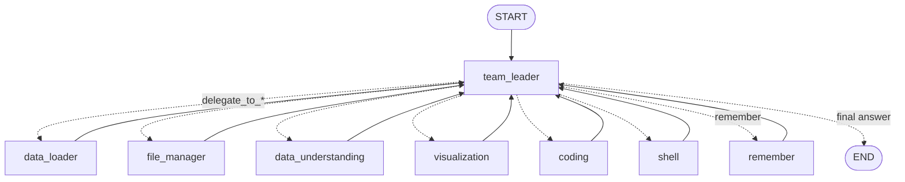
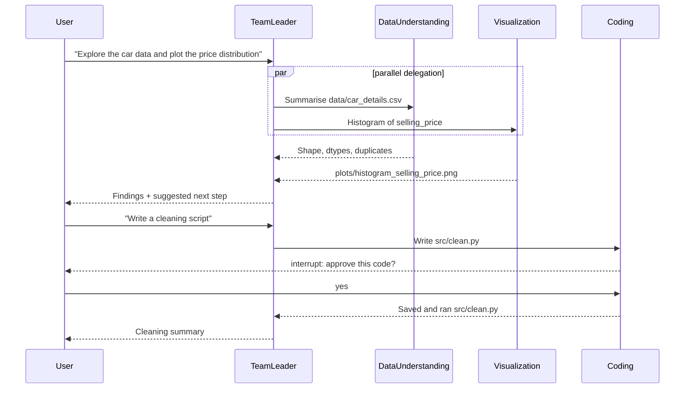

# 🤖 Multi-Agent Data Science Team (LangChain + LangGraph)

An AI-powered data science team where a **Team Leader agent** coordinates **six specialised agents** to take a dataset through the full ML workflow: loading, exploration, cleaning, visualisation, feature engineering and model building. You talk to it in plain English, and it plans the work and delegates each step to the right agent.

Built with **LangChain** agents orchestrated by a **LangGraph** supervisor graph, with human-in-the-loop approvals, persistent SQLite memory and a FastAPI REST API.


---

## 📸 System Architecture


### LangGraph graph

This is the actual graph, generated with `graph.get_graph().draw_mermaid()`:



How it works:

1. The **Team Leader** is a tool-calling LLM. To delegate, it calls a `delegate_to_<agent>` tool with a self-contained task.
2. LangGraph routes each call with **`Send`** to that agent's node. **Independent tasks run in parallel.**
3. Each specialist is a LangChain **`create_agent`** (ReAct loop) with its own tools. Its final answer returns to the Team Leader as the tool result.
4. `remember` calls save facts (data paths, model paths, preferences) into the graph's **session notes**.
5. A **SQLite checkpointer** saves the whole state per conversation thread, so the team remembers earlier sessions.

---

## 🎯 Key Features

- **Supervisor multi-agent architecture** built as an explicit LangGraph `StateGraph`
- **Six specialist agents**, each with only the tools it needs
- **Parallel delegation** with LangGraph `Send`
- **Human-in-the-loop approvals**: writing a file or installing a package pauses the graph with `interrupt()` until you approve, reject, or reply with feedback
- **Sandboxed tools**: file access is limited to the project folder, and shell commands are limited to an allow-list
- **Persistent memory**: conversations and session notes are stored in SQLite (`memory.db`)
- **Swappable LLM**: any provider supported by `init_chat_model`, set in `.env` (OpenAI `gpt-5-mini` by default, Groq Llama 3.3 as an option)
- **Three ways to use it**: terminal chat, REST API, or the LangGraph Studio UI
- **Tested without API keys**: pytest suite with a scripted fake model

---

## 🏗️ Agents

### Agent Hierarchy

```
User
  └── Team Leader (Project Manager)
       ├── Data Loader Agent         (CSV expert)
       ├── File Manager Agent        (file system)
       ├── Data Understanding Agent  (pandas / EDA)
       ├── Visualization Agent       (matplotlib charts)
       ├── Coding Agent              (ML engineer)
       └── Shell Agent               (runs scripts)
```

### Agent Responsibilities

| Agent | Role | What it does | Tools |
|-------|------|--------------|-------|
| **Team Leader** | Project Manager | Plans the ML pipeline, delegates tasks, keeps session notes | `delegate_to_*`, `remember` |
| **Data Loader** | CSV Expert | Lists datasets and previews rows (max 30) | `list_csv_files`, `read_csv_file`, `list_files` |
| **File Manager** | File System Manager | Lists, reads and writes project files | `list_files`, `read_file`, `write_file`* |
| **Data Understanding** | EDA Assistant | Shape, dtypes, describe, value counts, missing values, duplicates, correlations | `list_csv_files`, `dataframe_operation` |
| **Visualization** | Plotting Assistant | Bar, histogram, scatter, line, pie and box charts saved to `plots/` | `list_csv_files`, `dataframe_operation`, `create_chart` |
| **Coding** | ML Engineer | Writes and runs Python for cleaning, feature engineering, training and evaluation | `read_file`, `write_file`*, `run_python_file`, `install_package`*, `web_search` |
| **Shell** | Command Executor | Runs `uv run <file.py>` and read-only commands | `run_shell_command` (allow-listed), `list_files` |

\* needs your approval before it runs.

### Example flow



---

## 📁 Project Structure

```
multi-agent-data-science-team/
│
├── app.py                     # Terminal chat + FastAPI REST API (entry point)
├── langgraph.json             # LangGraph Studio config
│
├── ds_team/                   # The multi-agent system
│   ├── config.py              # Paths and LLM setup (MODEL from .env)
│   ├── tools.py               # Sandboxed LangChain tools (CSV, pandas, charts, files, Python, shell, search)
│   ├── agents.py              # The six specialist agents (create_agent)
│   ├── graph.py               # LangGraph supervisor graph + SQLite checkpointer
│   └── studio.py              # Graph entry point for `langgraph dev`
│
├── tests/                     # pytest suite (scripted model, no API key needed)
│
├── src/                       # Reusable ML pipeline scripts
│   ├── data_cleaning.py       # Duplicates, outliers, brand/model extraction, car age
│   ├── data_plotting.py       # Before/after selling-price histograms
│   └── preprocessing.py       # Train/test split, scaling + one-hot encoding
├── clean_car_data.py          # Standalone cleaning script
├── run_car_report.py          # Markdown EDA report for the dataset
│
├── data/
│   ├── car_details.csv        # Raw dataset (4,340 used-car listings)
│   ├── car_data_cleaned.csv   # Output of clean_car_data.py
│   ├── data_cleaned.csv       # Output of src/data_cleaning.py
│   ├── sample_cars.csv        # 20-row sample (used by the tests)
│   └── features/              # Processed train.csv / test.csv
├── models/                    # preprocessor.joblib
├── plots/                     # Charts created by the agents
├── reports/                   # EDA reports and cleaning logs
│
├── .env.example               # Template for API keys and model choice
├── pyproject.toml / uv.lock   # Dependencies (uv)
├── requirements.txt           # Dependencies for pip users
└── LICENSE
```

---

## 🚀 Getting Started

### Prerequisites

- **Python 3.13+**
- [uv](https://docs.astral.sh/uv/) (recommended) or pip
- An **OpenAI API key** (or a Groq API key)

### Installation

1. **Clone the repository**
   ```bash
   git clone https://github.com/goutham84/multi-agent-data-science-team.git
   cd multi-agent-data-science-team
   ```

2. **Install dependencies**

   With uv (recommended):
   ```bash
   uv sync
   ```

   Or with pip:
   ```bash
   python -m venv .venv
   # Windows
   .venv\Scripts\activate
   # Linux / macOS
   source .venv/bin/activate

   pip install -r requirements.txt
   ```

3. **Add your API key**
   ```bash
   cp .env.example .env
   # then open .env and paste your OPENAI_API_KEY
   ```

### Option 1: Chat in the terminal

```bash
uv run app.py
```

```text
Data Science Team (thread 3f2c...). Type 'exit' to quit.

You: Load car_details.csv and tell me about the data
  -> data_loader done
  -> data_understanding done
  -> team_leader done

Team Leader: The dataset has 4,340 rows and 8 columns...
```

When an agent wants to write a file, you see the code and answer `yes`, `no`, or type feedback such as `use pathlib instead`. The agent then revises its code.
To continue an earlier conversation, run `uv run app.py --thread <thread-id>`.

### Option 2: REST API

```bash
uv run app.py --serve
```

Interactive docs: `http://127.0.0.1:7777/docs`

| Method | Endpoint | Purpose |
|--------|----------|---------|
| `POST` | `/chat` | `{"message": "...", "thread_id": "optional"}` → reply, or pending approvals |
| `POST` | `/approve` | `{"thread_id": "...", "answers": {"<approval id>": "yes"}}` → resume the graph |
| `GET` | `/threads/{thread_id}` | Conversation history and session notes |
| `GET` | `/health` | Health check |

### Option 3: LangGraph Studio (visual UI)

```bash
uv run langgraph dev
```

This opens LangGraph Studio, where you can chat with the team, watch each node run, inspect the state and approve interrupts in the browser. It requires a free LangSmith account.

---

## 💡 Example Prompts

```text
List all the CSV files in the data folder.
Load car_details.csv and show me the first 10 rows.
What are the numerical and categorical columns? Show value counts for fuel and transmission.
Plot a histogram of selling_price and a pie chart of seller_type.
Remember that the cleaned data is in data/data_cleaned.csv.
Write a script that removes duplicates and outliers in selling_price and km_driven.
Train a RandomForest on data/features/train.csv and evaluate it on test.csv.
```

### Run the pipeline scripts directly

```bash
uv run run_car_report.py        # EDA report  -> reports/car_data_report.md
uv run src/data_cleaning.py     # Cleaning    -> data/data_cleaned.csv
uv run src/data_plotting.py     # Plots       -> plots/
uv run src/preprocessing.py     # Features    -> data/features/, models/preprocessor.joblib
```

---

## 🔧 Configuration

All settings live in `.env`:

```env
MODEL=openai:gpt-5-mini                # or groq:llama-3.3-70b-versatile
OPENAI_API_KEY=your_openai_api_key_here
GROQ_API_KEY=your_groq_api_key_here    # only if you use Groq

# Optional: trace every agent step in LangSmith
LANGSMITH_TRACING=true
LANGSMITH_API_KEY=your_langsmith_api_key_here
```

> ⚠️ **Security note:** the Coding Agent can run Python files from the project. Every file write and package install needs your approval, and shell commands are allow-listed, but approved code still runs on your machine. Only approve code you have read, and keep the API bound to `127.0.0.1`.

---

## 🧪 Tests

```bash
uv run pytest
```

The tests use a scripted fake chat model, so they run offline with no API key. They cover:
- delegation and session notes
- parallel delegation
- the approve and reject flow for file writes
- sandboxing of file paths, shell commands and package names
- every data tool

---

## 🛠️ Technology Stack

| Area | Tools |
|------|-------|
| Agents | LangChain 1.x (`create_agent`, tools, `init_chat_model`) |
| Orchestration | LangGraph 1.x (`StateGraph`, `Send`, `interrupt`, checkpointers) |
| LLMs | OpenAI GPT-5-mini, Groq Llama 3.3 70B |
| Memory | SQLite checkpointer (`langgraph-checkpoint-sqlite`) |
| API | FastAPI, Uvicorn |
| Data processing | pandas, NumPy |
| Visualisation | Matplotlib, Seaborn |
| Machine learning | scikit-learn, joblib |
| Web search | DuckDuckGo (`ddgs`) |
| Tooling | uv, pytest, LangGraph Studio |

---

## 📊 Dataset

The demo uses a used-car listings dataset (`data/car_details.csv`, 4,340 rows) with these columns:
`name`, `year`, `selling_price`, `km_driven`, `fuel`, `seller_type`, `transmission`, `owner`.

The cleaning step removes 763 exact duplicates and 63 extreme outliers (0.5th–99.5th percentile), and adds `brand`, `model` and `age`. See [reports/cleaning_log_data_cleaned.md](reports/cleaning_log_data_cleaned.md).

---

## 📈 Roadmap

- [ ] Model training & evaluation script (`src/train.py`) with MAE / RMSE / R² metrics
- [ ] Stream the agents' tokens to the terminal and API (`stream_mode="messages"`)
- [ ] Long-term memory across threads with a LangGraph `Store`
- [ ] Run the Coding Agent's code in a Docker sandbox
- [ ] Support more data formats (Excel, JSON, Parquet)
- [ ] GitHub Actions CI running the test suite

---

## 🤝 Contributing

Contributions are welcome!

1. Fork the repository
2. Create a feature branch (`git checkout -b feature/AmazingFeature`)
3. Commit your changes (`git commit -m "Add some AmazingFeature"`)
4. Push to the branch (`git push origin feature/AmazingFeature`)
5. Open a Pull Request

---

## 📝 License

This project is licensed under the MIT License. See the [LICENSE](LICENSE) file for details.

---

## 👨‍💻 Author

**Goutham Kachhawa**

- GitHub: [@goutham84](https://github.com/goutham84)
- LinkedIn: [goutham84](https://www.linkedin.com/in/goutham84/)
- Email: [goutham.kachhawa82@gmail.com](mailto:goutham.kachhawa82@gmail.com)

---

## 🙏 Acknowledgments

- [LangChain](https://github.com/langchain-ai/langchain) and [LangGraph](https://github.com/langchain-ai/langgraph) for the agent and orchestration frameworks
- The open-source Python data science community

---

## 📞 Support

If you have questions or find a bug:

- Open an [issue](https://github.com/goutham84/multi-agent-data-science-team/issues)
- Email [goutham.kachhawa82@gmail.com](mailto:goutham.kachhawa82@gmail.com)

---

**Made with ❤️ by [Goutham Kachhawa](https://github.com/goutham84)**
